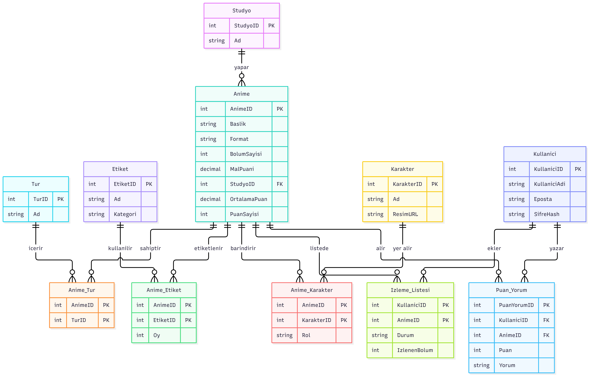

# Anime Takip Sistemi

Veri tabanı yönetimi dersi için geliştirdiğim proje. Kullanıcıların animeleri arayıp izleme listelerine ekleyebildiği, puanlayıp yorum yazabildiği bir web uygulaması.

## Proje Bilgileri
- Öğrenci: Fatma Betül Aşkın
- Ders: Veri Tabanı Yönetimi
- Veri kaynağı: AniList GraphQL API (Gerçek anime verisi; Jikan API açık servislerinin kapanması sebebiyle geçiş yapılmıştır)

## Kullanılan Teknolojiler
- Veritabanı: Microsoft SQL Server (T-SQL)
- Veri Çekme: Python (requests, pyodbc) ve AniList GraphQL API

## Veritabanı Yapısı

Tablolar (Toplam 10 Tablo):
- Anime
- Studyo
- Tur
- Anime_Tur
- Karakter
- Anime_Karakter
- Etiket
- Anime_Etiket
- Kullanici
- Izleme_Listesi
- Puan_Yorum

## Özellikler
- Anime arama ve filtreleme
- İzleme listesi (İzliyorum / Bitirdim / İzlenecek / Bıraktım)
- Puanlama ve yorum sistemi
- **Trigger (`trg_PuanGuncelle`):** Bir kullanıcı animeye yeni puan verdiğinde veya sildiğinde Anime tablosundaki ortalama puanı ve oy sayısını otomatik günceller.
- **View (`vw_EnYuksekPuanlilar`):** En yüksek puanlı 50 animeyi stüdyo bilgileriyle listeleyen hazır görünüm.
- **Stored Procedure (`sp_ListeyeEkle`):** İzleme listesi durum kontrolü ve ekleme/güncelleme saklı yordamı.
- **Stored Procedure (`sp_OneriGetir`):** Kullanıcının yüksek puan verdiği türlere göre listesinde olmayan anime önerilerini getiren saklı yordam.

---

## Haftalık Log

##### Hafta 1
* Proje konusu seçildi, GitHub reposu açıldı.
* Veri kaynakları ve gereksinimler araştırıldı.

##### Hafta 2
* 3NF normalizasyonuna uygun ilişkisel veritabanı şeması ve ER diyagramı tasarlandı.

##### Hafta 3
* Microsoft SQL Server üzerinde `AnimeTakipDB` veritabanı ve `database.sql` şeması oluşturuldu.
* 10 ilişkisel tablo, 1 Trigger (`trg_PuanGuncelle`), 1 View (`vw_EnYuksekPuanlilar`) ve 2 Stored Procedure (`sp_ListeyeEkle`, `sp_OneriGetir`) kodlandı.

##### Hafta 4
* Jikan API açık servisinin kapanması nedeniyle veri sağlayıcı olarak **AniList GraphQL API**'sine geçiş yapıldı.
* AniList veri mimarisine uyum sağlamak amacıyla `Bolum` tablosu yerine `Etiket` ve `Anime_Etiket` tabloları eklendi (10 tablo yapısı korundu).
* Python tabanlı `veri-cekme/fetch_anilist.py` betiği ve `requirements.txt` bağımlılıkları hazırlanarak gerçek anime, stüdyo, karakter ve etiket verileri SQL Server'a aktarıldı.